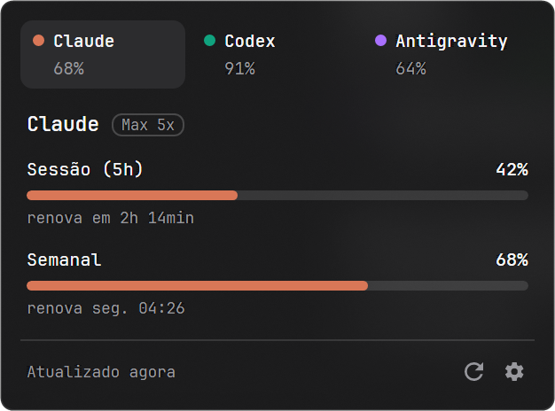

# AI Usage Widget

**Os limites do Claude, do Codex e do Antigravity, de relance, na sua área de trabalho.**

[**Baixar**](https://github.com/Azincourt-tech/Widget-Ai-Usage/releases/latest) · [Primeiros passos](#primeiros-passos) · [Perguntas frequentes](#perguntas-frequentes) · [Guia técnico](docs/DESENVOLVIMENTO.md)

---

Um widget de área de trabalho que mostra quanto você ainda pode usar das suas IAs: **Claude**, **ChatGPT/Codex** e **Antigravity** (IDE e CLI). Cada conta aparece com anéis, no estilo do Apple Watch, que mostram o uso da sessão de 5 horas, do dia ou da semana, quando cada limite renova e o seu plano.

## Recursos

- 🎯 **Tudo num lugar só:** Claude, Codex e Antigravity lado a lado, atualizados a cada minuto.
- ⏱️ **Quando renova:** cada anel mostra quanto falta para o limite voltar.
- 🔔 **Avisos:** notificação do Windows quando um limite passa de 80% e de 95%.
- 🎨 **Do seu jeito:** temas Vidro, Escuro e Claro, em três tamanhos.
- 📌 **Widget ou bandeja:** flutuando na área de trabalho ou como um ícone ao lado do relógio, que abre os limites com um clique.
- 🔒 **Login oficial:** você entra na página de cada serviço, e o acesso fica no cofre do Windows. Nenhum dado sai do seu computador.
- 📦 **Sem instalação:** um arquivo só, é baixar e abrir.

## Visual

| Vidro | Escuro | Claro |
|---|---|---|
|  |  |  |

| Pequeno | Grande | Configurações |
|---|---|---|
|  |  |  |

| No modo bandeja |
|---|
|  |

> Em desenvolvimento. Funciona no Windows; o Linux vem em seguida.

## Como baixar

Baixe o arquivo `AiUsageWidget-vX.Y.Z-win-x64.exe` da versão mais recente em [Releases](https://github.com/Azincourt-tech/Widget-Ai-Usage/releases) e abra. É um arquivo só: não precisa instalar nada.

- Funciona no Windows 10 (versão 2004 ou mais nova) e no Windows 11.
- Na primeira vez, o Windows pode mostrar "O Windows protegeu o computador", porque o arquivo não tem assinatura digital. Clique em **Mais informações** e depois em **Executar assim mesmo**.
- Guarde o arquivo numa pasta fixa (por exemplo, `Documentos\AI Usage Widget`) antes de ligar "Iniciar com o Windows": se ele mudar de lugar, o Windows não o encontra mais.

## Primeiros passos

1. Abra o widget. Ele aparece no canto superior direito da tela.
2. Em cada conta, clique em **Entrar**. O login abre no seu navegador, na página oficial de cada serviço; quando terminar, volte ao widget.
   - **Claude:** a sua conta do Claude (Pro, Max, Team ou Enterprise).
   - **Codex:** a sua conta do ChatGPT.
   - **Antigravity:** a sua conta Google. A cota é a mesma para o Antigravity IDE e o Antigravity CLI, e não precisa ter nenhum dos dois instalado.
3. Pronto: os anéis aparecem e se atualizam sozinhos a cada minuto.

Não usa alguma dessas IAs? Esconda a conta nas configurações.

## No dia a dia

- **Anéis:** cada um mostra quanto do limite já foi usado e, embaixo, quando ele renova. Ficam laranja a partir de 75% e vermelhos a partir de 90%. No tamanho pequeno, passe o mouse sobre um anel para ver quando ele renova.
- **Avisos:** quando um limite passa de 80% e de 95%, o widget mostra uma notificação do Windows (só no momento em que passa, não toda vez que abre).
- **Botões:** passe o mouse sobre o widget para ver, à direita, configurações, fixar (deixa o widget sempre por cima das outras janelas) e fechar.
- **Clique com o botão direito** para ver quando foi a última leitura e para **atualizar agora**.
- **Arraste** o widget por qualquer parte. Ele lembra onde ficou.
- **Sair de uma conta:** passe o mouse sobre ela e clique no ícone de sair, ao lado do plano.

### No modo bandeja

Em **Configurações > Mostrar como**, escolha **Bandeja** para trocar o widget por um ícone na área de notificação, ao lado do relógio.

- **Passe o mouse** sobre o ícone para ver o uso de cada conta.
- **Clique** no ícone para abrir uma janelinha com uma aba por conta: cada limite aparece numa barra, com quando renova. Ela fecha ao clicar fora, ao clicar de novo no ícone ou com **Esc**.
- **Clique com o botão direito** no ícone para atualizar agora, abrir as configurações ou **sair**.
- No Windows 11, ícones novos ficam escondidos na seta **^** da área de notificação. Para deixar o ícone sempre à vista, arraste-o da seta para a barra (ou ligue-o em **Configurações do Windows > Personalização > Barra de tarefas > Outros ícones da bandeja do sistema**).

## Configurações

- **Mostrar como:** **Widget** (na área de trabalho) ou **Bandeja** (um ícone ao lado do relógio). Vale na hora, sem reiniciar.
- **Tema:** Vidro (transparente com desfoque), Escuro ou Claro.
- **Tamanho:** pequeno, médio ou grande (do widget).
- **Contas no widget:** escolha quais aparecem. As escondidas não são consultadas.
- **Avisar em 80% e 95%:** liga ou desliga as notificações.
- **Iniciar com o Windows:** abre o widget sozinho quando você entra no Windows.

## Perguntas frequentes

**Consultar os limites gasta o meu uso ou custa algo?**
Não. O widget só lê o status da conta, sem usar nenhum modelo de IA, então nada é descontado do seu limite nem cobrado.

**É um aplicativo oficial da Anthropic, OpenAI ou Google?**
Não. É um projeto independente que usa os mesmos endereços que os aplicativos oficiais usam para mostrar o uso. Se um desses serviços mudar algo, uma conta pode parar de funcionar até sair uma versão nova do widget.

**Por que não aparece o limite diário do Antigravity?**
O Google só informa limites semanais nos planos que testamos. O widget mostra o que o serviço informar.

**Escolhi Bandeja e o ícone não aparece.**
No Windows 11, ícones novos ficam escondidos: clique na seta **^** ao lado do relógio. Veja acima como deixar o ícone sempre à vista.

**O limite do Opus não aparece no Claude.**
Ele só aparece quando o seu plano tem um limite separado para o Opus. Nos outros, o uso do Opus entra no limite semanal geral.

## Privacidade

Tudo fica no seu computador. O widget não tem servidor próprio e nunca vê a sua senha: o login é feito na página oficial, no seu navegador. O acesso fica guardado no Gerenciador de Credenciais do Windows, e você pode sair da conta a qualquer momento.

## Como remover

1. Nas configurações, desligue **Iniciar com o Windows** e feche o widget (no modo bandeja: clique com o botão direito no ícone e em **Sair**).
2. Apague o arquivo `.exe`.
3. Se quiser apagar também o que ficou guardado:
   - as configurações, na pasta `%APPDATA%\AiUsageWidget`;
   - os logins, no **Gerenciador de Credenciais do Windows** (Credenciais do Windows), nos itens que começam com `AiUsageWidget/`.

---

Para quem quer compilar ou contribuir: veja o [guia técnico](docs/DESENVOLVIMENTO.md). Licença [MIT](LICENSE).
