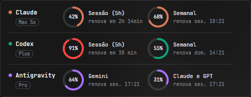
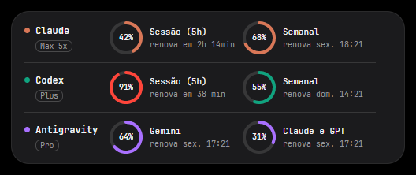
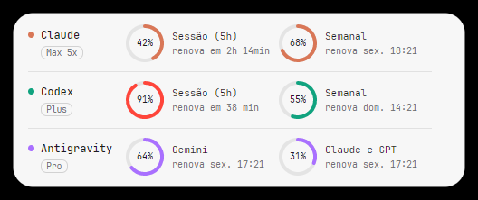
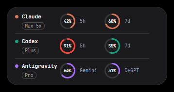
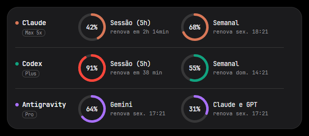
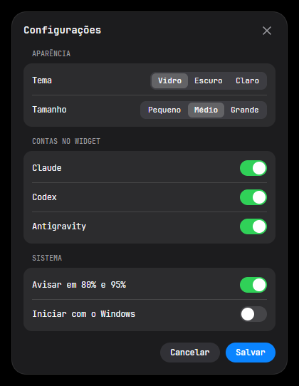

# AI Usage Widget

Um widget de área de trabalho que mostra, de relance, quanto você ainda pode usar das suas IAs: **Claude**, **ChatGPT/Codex** e **Antigravity** (IDE e CLI). Cada conta aparece com anéis que mostram o uso da sessão de 5 horas, do dia ou da semana, quando cada limite renova e o seu plano.

| Vidro | Escuro | Claro |
|---|---|---|
|  |  |  |

| Pequeno | Grande | Configurações |
|---|---|---|
|  |  |  |

> Em desenvolvimento. Funciona no Windows; o Linux vem em seguida (o macOS não é suportado).

## Como usar

- Em cada conta, clique em **Entrar**. O login abre no seu navegador; quando terminar, volte ao widget.
  - O Codex usa a sua conta do ChatGPT.
  - O Antigravity usa a sua conta Google. A cota é a mesma para o Antigravity IDE e o Antigravity CLI, e não precisa ter nenhum dos dois instalado.
- Passe o mouse sobre o widget para ver os botões à direita: configurações, fixar e fechar.
- Clique com o botão direito para ver quando foi a última leitura e para **atualizar agora**.
- Nas **configurações** você escolhe o tema, o tamanho (pequeno, médio ou grande), quais contas aparecem, se avisa em 80% e 95% e se o widget inicia com o Windows.
- Os limites são relidos a cada minuto. Se uma conta passa uns 20 minutos sem mudar, o widget dá uma pausa curta nela para não consultar à toa.
- Arraste o widget por qualquer parte.
- Quando um limite passa de 80% e de 95%, o widget avisa com uma notificação do Windows (só no momento em que passa, não toda vez que abre). Dá para desligar nas configurações.
- Os anéis ficam laranja a partir de 75% de uso e vermelhos a partir de 90%. No tamanho pequeno, passe o mouse sobre um anel para ver quando ele renova.

## Como compilar

Precisa do SDK do .NET 10.

```bash
dotnet build AiUsageWidget.sln
dotnet run --project src/AiUsageWidget
```

O conector do Antigravity precisa do `client_secret` do app OAuth do Antigravity, que não fica no repositório. Copie `Directory.Build.local.props.example` para `Directory.Build.local.props` e preencha o valor (o arquivo explica onde encontrar), ou defina a variável de ambiente `AntigravityClientSecret`. Sem ele, o widget funciona com Claude e Codex, e o card do Antigravity avisa que não está configurado.

Para ver o widget com contas fictícias: `dotnet run --project src/AiUsageWidget -- --demo`.

## Privacidade

Tudo fica no seu computador. O widget não tem servidor próprio e nunca vê a sua senha: o login é feito na página oficial, no seu navegador. O acesso fica guardado no Gerenciador de Credenciais do Windows, e você pode sair da conta a qualquer momento (ícone de sair ao passar o mouse sobre a conta).
